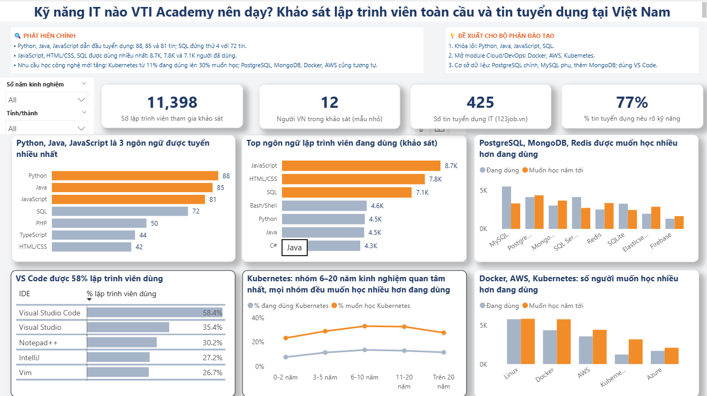

# Phân tích nhu cầu kỹ năng IT cho VTI Academy

Dự án cuối khóa Data Analysis tại VTI Academy (điểm 10/10). Mình đóng vai Data Analyst mới vào VTI Academy, phân tích kỹ năng IT nào đang được dùng nhiều, được muốn học nhiều và được tuyển dụng nhiều ở Việt Nam, rồi đưa ra đề xuất cho bộ phận đào tạo.

## Dữ liệu

| Nguồn | Quy mô | Dùng để |
|---|---|---|
| Khảo sát Stack Overflow | hơn 11.000 người trả lời | Xu hướng kỹ năng toàn cầu (đang dùng và muốn học) |
| Tin tuyển dụng 123job.vn (tự cào) | 425 tin | Nhu cầu tuyển dụng thực tế tại Việt Nam |

Khảo sát chỉ có 12 người Việt Nam, nên mình dùng khảo sát cho xu hướng chung, còn nhu cầu ở Việt Nam lấy từ tin tuyển dụng. Hai nguồn không nối trực tiếp với nhau mà được so sánh theo thứ hạng.

> File khảo sát gốc (`Final Project.csv`, khoảng 28 MB) không đưa lên repo vì vượt giới hạn của GitHub. Bạn có thể tải tại [Stack Overflow Developer Survey](https://survey.stackoverflow.co/).

## Quy trình

1. **Thu thập**: cào tin tuyển dụng từ 123job.vn bằng Python (`1_thu thap/`)
2. **Làm sạch**: chuẩn hóa tên kỹ năng, tách bảng (`2_lam sach/`)
3. **EDA**: phân tích bằng Python, xuất bảng tổng hợp và biểu đồ (`3_EDA/`)
4. **SQL**: dựng database `VTI_SkillDemand` trên SQL Server (`VTI_SkillDemand.sql`)
5. **Dashboard**: Power BI (`dashboard_pbi/DB.pbix`)

## Kết quả chính

- **Python và Java dẫn đầu tuyển dụng ở Việt Nam** (Java có trong 18,0% tin, Python 17,8%). Python còn là ngôn ngữ phổ biến hiếm hoi có người muốn học nhiều hơn người đang dùng (46,5% muốn học so với 39,9% đang dùng).
- **JavaScript, HTML/CSS và SQL là nền tảng**: dùng nhiều nhất trong khảo sát (76,3%, 68,8%, 62,4%) và đều nằm trong top 6 tuyển dụng.
- **Ngôn ngữ đang lên**: TypeScript, Go và Kotlin có tỷ lệ muốn học cao hơn hẳn đang dùng (Go 24,5% so với 9,8%, Kotlin 16,8% so với 6,6%).
- **Database**: SQL vẫn là chính (93,5% người trả lời đang dùng), nhưng NoSQL như MongoDB, Redis, Elasticsearch có nhu cầu muốn học tăng. PostgreSQL là database quan hệ duy nhất có tỷ lệ muốn dùng cao hơn đang dùng.
- **Công nghệ mới**: Kubernetes, Docker, React và AWS được muốn học nhiều. React có trong 21,2% tin tuyển dụng Việt Nam.

## Đề xuất cho VTI Academy

1. **Khóa lõi**: Python, Java, JavaScript, SQL.
2. **Mở module Cloud/DevOps**: Docker, AWS, Kubernetes.
3. **Cơ sở dữ liệu**: PostgreSQL là chính, MySQL là phụ, thêm MongoDB; dạy trên VS Code.

## Công cụ

Python (requests, BeautifulSoup, pandas), SQL Server, Power BI
